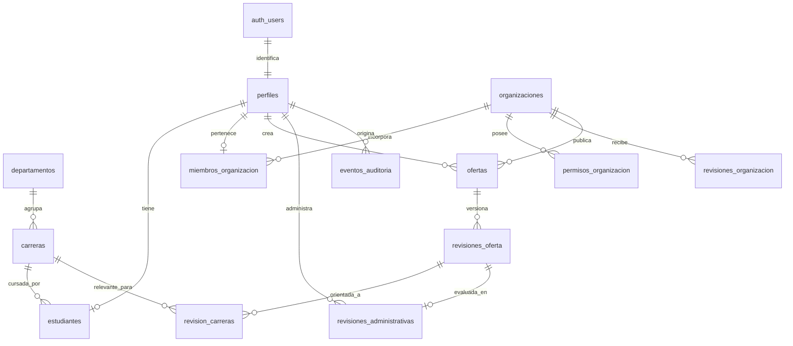
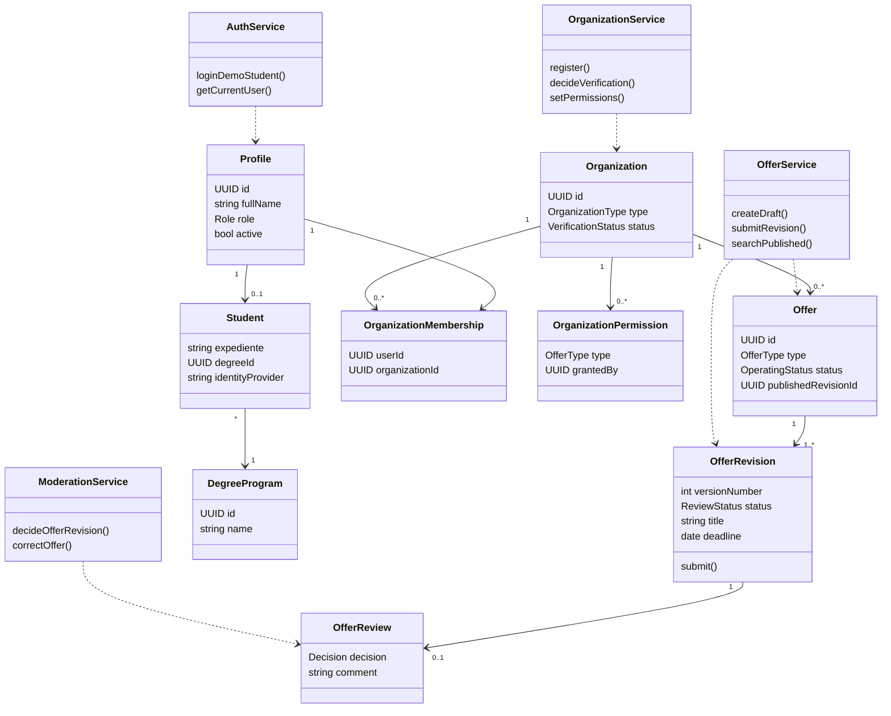

# UniOportunidades — especificación funcional y técnica (v1.0)

**Estado:** decisiones de producto aprobadas para un prototipo funcional.  
**Idioma de la aplicación:** español (`es-MX`).  
**Objetivo:** sitio independiente para consultar, publicar y moderar oportunidades de servicio social y prácticas profesionales de la Universidad de Sonora. **No gestiona postulaciones, horas acreditadas ni el expediente oficial.**  
**Nota institucional:** proyecto académico no afiliado ni integrado oficialmente a la universidad. No usar logotipo oficial ni afirmar integración real sin autorización.

## 1. Decisiones cerradas

1. **Tres roles:** `student` (estudiante), `publisher` (publicador), `admin` (administrador). La identidad `publisher` es un usuario que representa a una organización, no un tipo distinto por cada institución.
2. **Organizaciones:** pueden ser empresa, unidad universitaria, organismo público u organización civil (`company`, `university`, `government`, `nonprofit`, `other`). El tipo **no** define automáticamente qué puede publicar.
3. **Permisos por organización:** el administrador activa individualmente `social_service` y/o `internship`. La aprobación de una organización es independiente de la aprobación de cada oferta.
4. **Estudiantes:** no se autorregistran. En el prototipo existen cuentas sembradas en Supabase Auth. Inicio de sesión visible por **expediente + contraseña de DEMOSTRACIÓN**; jamás se usa la contraseña real del portal. En producción este adaptador se sustituiría por un proveedor institucional SSO autorizado.
5. **Publicadores:** se registran con correo propio + contraseña, validan su correo y completan solicitud de organización; admin verifica la organización y define permisos. Pueden navegar el catálogo al autenticarse, aun cuando su organización esté pendiente, pero no enviar ofertas hasta tener permiso.
6. **Administradores:** cuentas creadas por provisión segura, nunca autorregistro.
7. **Ofertas:** servicio social o prácticas profesionales; publicación requiere revisión del administrador. La edición de una oferta aprobada crea una nueva versión pendiente sin ocultar la última versión aprobada.
8. **El sitio NO gestiona solicitudes/postulaciones:** muestra contacto externo provisto por la organización (correo, enlace o instrucciones). No hay botón «Postularse» interno.
9. **Alcance MVP:** login real del prototipo, registro/verificación de organizaciones, permisos, ofertas/revisiones, filtros por carrera/tipo, paneles, persistencia, control de acceso, datos demostrativos y pruebas básicas. Extras opcionales al final.

## 2. Stack técnico

- **Web:** React + Vite + TypeScript, React Router, TanStack Query, React Hook Form, Zod, Tailwind CSS, shadcn/ui, lucide-react.
- **API:** Node.js + Express + TypeScript, Zod, `pg` para transacciones PostgreSQL, `@supabase/supabase-js` para autenticación/verificación y provisión de cuentas.
- **Datos:** Supabase-hosted PostgreSQL; SQL con migraciones versionadas (`db/migrations`). No ORM requerido para la v1, para que el esquema esté explícito.
- **Identidad:** Supabase Auth. Web obtiene sesión y llama Express con `Authorization: Bearer <access_token>`. El backend valida token con Supabase Auth (claims verificados o `getUser`); obtiene rol y permisos **desde DB**, jamás desde inputs del cliente.
- **Acceso a DB:** todas las operaciones de negocio pasan por Express. Credenciales `DATABASE_URL` y `SUPABASE_SERVICE_ROLE_KEY` existen **solo en el servidor**. Activar RLS en tablas expuestas y **no crear políticas de acceso directo** de anon/authenticated en este MVP: las consultas de negocio las hace un backend confiable. Conexión PostgreSQL del servidor con rol que tenga permisos suficientes para esas operaciones. Si se agrega acceso directo del cliente en el futuro, diseñar políticas RLS antes de habilitarlo.
- **Seguridad mínima:** contraseñas exclusivamente en Supabase Auth, validación en API, autorización por organización y rol, CORS explícito, rate limit al login/registro, manejo genérico de errores de credenciales, jamás mostrar llaves de servicio.
- **Pruebas:** Vitest + Supertest para servicios y rutas; Playwright para el flujo de demostración si es factible.

### Estructura de repositorio

```text
unioportunidades/
  apps/
    web/
      src/
        app/                # router, providers, auth bootstrap
        components/         # ui/, layout/, ofertas/, formularios/
        features/           # auth, catalogo, publicador, admin, perfil
        hooks/
        lib/                # apiClient, supabaseClient, validation
        styles/
      .env.example
    api/
      src/
        app.ts
        server.ts
        config/
        db/                 # pool, transactions, repositories
        middleware/         # authenticate, requireRole, errors, limiter
        modules/
          auth/
          organizations/
          offers/
          reviews/
          catalog/
          admin/
        shared/             # errors, types, validation
      .env.example
  db/
    migrations/
      001_init.sql
  scripts/
    seed-demo.ts
  docs/
    architecture.md
    api.md
  .gitignore
  package.json              # workspaces + scripts
  README.md
```

## 3. Modelo de roles y permisos

| Operación | Estudiante | Publicador | Administrador |
|---|:---:|:---:|:---:|
| Ver catálogo publicado y detalles/contacto | Sí | Sí | Sí |
| Buscar por texto, tipo, carrera, ubicación, modalidad | Sí | Sí | Sí |
| Crear cuenta de estudiante | No | No | No |
| Solicitar registro de organización | No | Sí | No (admin puede crear mediante herramienta protegida) |
| Crear / editar borradores de su organización | No | Sí, con organización aprobada y permiso de tipo | Sí |
| Enviar oferta a revisión | No | Sí, según permiso | Sí |
| Ver sus propias ofertas y rechazos | No | Sí | Sí, todas |
| Aprobar / rechazar organización | No | No | Sí |
| Asignar permisos de publicación a organización | No | No | Sí |
| Aprobar / rechazar revisión de oferta | No | No | Sí |
| Cerrar / reabrir oferta publicada | No | Solo sus ofertas | Sí |
| Editar / archivar cualquier oferta | No | No | Sí |
| Gestionar usuarios/organizaciones (limitado en MVP) | No | No | Sí |

**Reglas estrictas:** un publicador pertenece a una sola organización en la v1. No se permite crear/mover miembros entre organizaciones desde la interfaz. Publicador pendiente de validación puede consultar catálogo y ver el estado de su solicitud; no crea ni envía borradores hasta su aprobación. Admin no puede concederse rol desde la interfaz de registro.

## 4. Entidades del dominio y relaciones

**`perfiles` (Profile)**: corresponde 1:1 a `auth.users`. Atributos `id`, `nombre_completo`, `email`, `rol`, `activo`, marcas de tiempo. El rol lo asigna exclusivamente el backend en flujos aprobados.

**`estudiantes` (Student)**: corresponde 1:1 a `perfiles` con rol student; `expediente` único; `carrera_id`; `proveedor_identidad`, `sujeto_externo` para futura federación. Los datos académicos son demostrativos y no se sincronizan con UNISON.

**`organizaciones` (Organization)**: tipo, nombre, descripción, web, correo, teléfono, estado `pending|approved|rejected|suspended`, metadatos de revisión.

**`miembros_organizacion` (OrganizationMembership)**: asocia publicador y organización. En v1, una organización puede tener varios publicadores, un publicador solo pertenece a una organización.

**`permisos_organizacion` (OrganizationPermission)**: combinación `(organizacion_id, tipo_oferta)` concedida o revocada por admin. No se deduce del tipo de organización.

**`revisiones_organizacion` (OrganizationReview)**: bitácora de aprobar, rechazar o suspender organización, con nota y administrador.

**`departamentos` (Department)** y **`carreras` (DegreeProgram)**: catálogos jerárquicos. Una carrera pertenece a un departamento. Los datos semilla se deben presentar como ejemplos verificables o ficticios, no como catálogo institucional oficial si no se confirmó.

**`ofertas` (Offer)**: identidad persistente de una oportunidad; `organizacion_id`, `creado_por`, `tipo`, `estado_operativo` (`open|closed|archived`), `revision_publicada_id` nullable, marcas de tiempo. Una oferta puede no tener aún versión visible.

**`revisiones_oferta` (OfferRevision)**: instantáneas versionadas `numero_version`, `estado_revision` (`draft|pending|approved|rejected`), campos editables completos (título, descripción, requisitos, beneficios, modalidad, ciudad, cupos, fechas, contacto). Una revisión `pending` se congela. Para modificarla se debe rechazar y crear otro borrador, o editar mientras está en `draft`.

**`revision_carreras` (RevisionDegree)**: relación M:N entre una revisión y carreras, para que cambiar carreras también quede sujeto a aprobación. La revisión define `alcance_carreras`: `all` o `selected`. Si `selected`, debe tener al menos una carrera.

**`revisiones_administrativas` (OfferReview)**: decisión de administración sobre una revisión, administrador, fecha y motivo. Una única decisión final por revisión.

**`eventos_auditoria` (AuditEvent)**: acciones sensibles (cambios de roles, verificación de organización, cambio de permisos, cierre de oferta, ediciones de admin), con actor, entidad, acción, fecha y metadatos JSON mínimos. No almacenar contraseñas, tokens o secretos.

**Opcional posteriormente:** `favoritos`, `notificaciones`, analítica, archivos adjuntos e historial de lectura. No implementar para el MVP si compromete el flujo principal.

### Diagrama ER simplificado (Mermaid)



Nota: `auth_users` denota `auth.users` (tabla administrada por Supabase). La referencia opcional `ofertas.revision_publicada_id` apunta a una sola versión aprobada de esa misma oferta. El API garantiza la pertenencia en una transacción; se puede reforzar con restricción FK compuesta.

### Diagrama de clases de dominio (orientativo)



En implementación, los campos tipados y métodos pueden representarse con interfaces/funciones TypeScript. El diagrama documenta responsabilidades conceptuales, no exige programar entidades con clases pesadas.

## 5. Reglas de negocio y máquinas de estados

### A. Organización

`pending → approved | rejected`; desde approved puede pasar a suspended. Admin registra fecha/actor/razón. Una organización rechazada puede contactar a admin o presentar nueva solicitud según futuras reglas; **no autorizar automáticamente**. Solo las organizaciones approved con permiso explícito en el tipo correspondiente pueden **enviar** una oferta. En el MVP también exigir aprobación para crear borradores.

### B. Oferta y revisiones

1. Publicador crea `ofertas` con revisión 1 `draft`.
2. Valida campos obligatorios y carreras, luego envía: `draft → pending`. Registrar `submitted_at`.
3. Admin ve cola, evalúa y elige `approve` o `reject` con motivo obligatorio si rechaza.
4. `approve`: en una **misma transacción**, registrar revisión administrativa, marcar revisión `approved`, asignar `ofertas.revision_publicada_id`, y poner estado operativo `open` si es publicación inicial. Evitar race conditions con bloqueo de filas.
5. `reject`: guardar motivo y marcar `rejected`, sin cambiar revisión pública anterior (si existe).
6. Edición posterior: crear nueva versión en `draft` a partir de la publicada o última rechazada, editar, enviar y revisar. Lo publicado sigue visible mientras exista revisión nueva pendiente.
7. Cierre: `open → closed`; reapertura de `closed → open` solo si existe revisión publicada vigente y organización habilitada. Archivado = baja lógica (`archived`), nunca borrar física ni historial para un flujo normal.
8. Vigencia **derivada**, no tercer estado mutable: expirada si `fecha_limite < hoy` en zona `America/Hermosillo`; no aparecer en catálogo aunque el estado operativo sea open. El API devuelve `vigente=false` para mostrar al propietario.
9. Moderación de edición administrativa: una edición de administrador crea nueva versión, puede aprobarla inmediatamente mediante flujo de decisión auditado; nunca actualizar silenciosamente una revisión aprobada.
10. Un publicador no puede aprobar sus ofertas, aumentar sus permisos ni editar ofertas de otras organizaciones. Todas estas comprobaciones deben ejecutarse en el backend.

### C. Catálogo

Mostrar únicamente ofertas `open`, con `revision_publicada_id` que apunta a revisión `approved`, `organizacion.status='approved'` y no vencidas. El contenido mostrado procede **siempre** de la revisión publicada, no de la revisión pendiente. Filtrar por `tipo`, `carrera_id`, `departamento_id`, `modalidad`, `ciudad`, `q` (texto), paginación y orden (recientes/fecha límite). Valor por defecto para estudiante: oportunidades acordes a su carrera **más** ofertas con alcance `all`; ofrecer botón «Ver todas» para ampliar. `all` incluye carreras de cualquier departamento; `selected` solo coincidencias de tabla puente. No prometer coincidencia por IA.

### D. Datos requeridos de una revisión

Título, descripción, tipo (en oferta, no editable tras creación), modalidad (`in_person|hybrid|remote`), ubicación (ciudad y estado o «remoto»), requisitos, actividades, beneficios opcionales, cupos positivos, fecha límite >= fecha actual al enviarse, alcance de carreras, contacto responsable (nombre y correo) y/o URL externa de contacto, instrucciones para interesados. Para servicio social se puede incluir duración/horas esperadas como **texto informativo**; no implica validación oficial de horas. Mostrar advertencia si la organización todavía no fue verificada.

## 6. Pantallas y experiencia de usuario

### Público no autenticado
- `/` portada explicativa, búsqueda limitada opcional sin datos personales, CTA «Iniciar sesión».
- `/iniciar-sesion` pestañas **Estudiante** (expediente y contraseña de demostración) y **Organización/Administración** (correo y contraseña).
- `/registro-organizacion` alta del publicador; confirmar correo, crear datos de organización, pendiente de aprobación. Si no confirmó correo, mostrar pasos, no crear organización a nombre de una sesión inexistente.

### Común autenticado
- `/ofertas` catálogo responsive con barra de búsqueda, filtros lateral/escritorio y drawer/móvil, tarjetas con tipo, organización, modalidad, carrera y fecha límite; indicador de resultados y estado vacío.
- `/ofertas/:id` detalle, contacto externo y contexto de carrera; sin postulación interna.
- `/mi-perfil` información básica, sesión/cerrar sesión.

### Estudiante
- Página de inicio personalizada con «Ofertas para tu carrera», botón «Ver todas», distinguir social/prácticas.

### Publicador
- `/publicador/panel`: recuentos borrador, pendiente, aprobada, rechazada, cerrada; estado de organización/permiso.
- `/publicador/ofertas`: tabla con filtros estado y tipo. Distinguir «versión publicada» y «edición pendiente».
- `/publicador/ofertas/nueva`: formulario con validación, guardar borrador y enviar.
- `/publicador/ofertas/:id/editar`: editar mediante nueva revisión; rechazo visible con motivo.
- `/publicador/organizacion`: perfil institucional y permisos; si pendiente, explicar bloqueo.

### Administrador
- `/admin/panel`: indicadores ofertas pendientes, organizaciones pendientes, publicadas y próximas a vencer.
- `/admin/organizaciones`: listado, detalle, aprobar/rechazar/suspender y activar tipos admitidos.
- `/admin/revisiones`: cola de revisiones, comparación con versión publicada, aprobar/rechazar con notas.
- `/admin/ofertas`: buscar, consultar, corregir con revisión auditada, cerrar/reabrir/archivar.
- `/admin/usuarios`: listado básico de cuentas; NO edición arbitraria de roles en MVP.

### Dirección visual
- Sitio luminoso, legible, limpio, más cercano a un job board moderno que a un ERP anticuado. Azul marino, neutros claros, acento verde/teal sobrio inspirado en entorno universitario **sin copiar identidad oficial**.
- Tipografía Inter o similar, radios suaves, iconos lucide, estados con etiquetas claras. Sidebar para paneles, navegación superior para catálogo.
- Accesibilidad: etiquetas de formularios, teclado, foco visible, contraste, mensajes de error en español, responsividad desde 360 px, confirmación para acciones destructivas.
- Textos de interfaz consistentes: «Servicio social», «Prácticas profesionales», «Publicar oportunidad», «Pendiente de revisión», «Organización verificada», «Rechazada».

## 7. Contratos API propuestos

Prefijo `/api/v1`, JSON uniforme: `{ data, error, meta }`. Error: `{error:{code,message,details?}}`; credenciales inválidas nunca revelan si el expediente existe. Validar esquemas Zod en todas las mutaciones.

| Método y ruta | Quién | Uso |
|---|---|---|
| POST `/auth/estudiantes/iniciar-sesion` | público, rate-limited | Recibe expediente y contraseña DEMO; busca identidad de prueba y autentica con Supabase Auth; retorna sesión para setSession del cliente |
| GET `/auth/yo` | autenticado | Perfil, rol, carrera y organización activa |
| POST `/organizaciones/registro` | usuario autenticado de alta como publicador | Crear perfil publisher/membresía/organización pending en transacción, verificar sesión y correo |
| GET `/organizaciones/mia` | publisher | Estado, datos y permisos |
| GET `/catalogos/carreras` | autenticado | Lista carreras/departamentos |
| GET `/ofertas` | autenticado | Catálogo publicado, filtros y paginación |
| GET `/ofertas/:id` | autenticado | Detalle de revisión publicada |
| GET `/publicador/ofertas` | publisher | Propias ofertas y revisiones |
| POST `/publicador/ofertas` | publisher autorizado | Crea oferta + revisión borrador |
| POST `/publicador/ofertas/:id/nueva-revision` | publisher dueño | Clona contenido aprobado/rechazado a nuevo borrador |
| PATCH `/publicador/revisiones/:id` | publisher dueño | Edita solo `draft` |
| POST `/publicador/revisiones/:id/enviar` | publisher dueño | Valida y pasa a `pending` |
| PATCH `/publicador/ofertas/:id/estado` | dueño o admin | Cerrar/reabrir con reglas |
| GET `/admin/organizaciones` | admin | Pendientes, aprobadas, filtros |
| POST `/admin/organizaciones/:id/decision` | admin | Aprueba/rechaza/suspende, registra razón |
| PUT `/admin/organizaciones/:id/permisos` | admin | Set de tipos permitidos |
| GET `/admin/revisiones` | admin | Cola pendiente |
| GET `/admin/revisiones/:id` | admin | Detalle/revisión anterior/diferencias |
| POST `/admin/revisiones/:id/decision` | admin | Aprobar/rechazar en transacción |
| GET `/admin/ofertas` | admin | Todas las ofertas y estados |
| POST `/admin/ofertas/:id/correccion` | admin | Nueva versión corregida + autoaprobación auditada |
| PATCH `/admin/ofertas/:id/estado` | admin | Cerrar/reabrir/archivar |
| GET `/admin/metricas` | admin | Conteos básicos |

Rutas y nombres pueden ajustarse en implementación con justificación documentada. **No ampliar alcance por añadir endpoints de postulaciones.**

## 8. Servicios/clases y responsabilidades

El proyecto usa **módulos TypeScript con servicios y repositorios**, no clases de herencia forzadas. Para documentación UML se consideran clases/entidades de dominio `Profile`, `Student`, `Organization`, `OrganizationMembership`, `OrganizationPermission`, `Offer`, `OfferRevision`, `OfferReview`, `Department`, `DegreeProgram`, `OrganizationReview`, `AuditEvent`.

- `AuthService`: adaptar identidad de estudiante demo (futuro `InstitutionalIdentityProvider`), usuario autenticado, sesiones y perfil. Abstracción `StudentIdentityProvider` con implementación `DemoStudentIdentityProvider`; futura implementación SSO sin cambiar lógica de ofertas.
- `OrganizationService`: autorregistro, membresías, estado, verificación y permisos.
- `OfferService`: creación, borradores, nuevas revisiones, validaciones, cierre y catálogo.
- `ModerationService`: decisiones administrativas transaccionales, revisión de organizaciones y ofertas, auditoría.
- `CatalogService`: consultas de departamentos y carreras, filtros normalizados.
- `AuthMiddleware`, `RequireRole`, `RequireOrganizationAccess`, `ErrorHandler`: seguridad transversal.
- Repositorios SQL `ProfilesRepository`, `OrganizationsRepository`, `OffersRepository`, `ReviewsRepository`, `CatalogRepository`; parametrizar siempre consultas para evitar SQL injection.

### Operaciones transaccionales obligatorias

- Registrar publisher + organización + membresía (proteger de dobles registros).
- Aprobar organización + registrar revisión + permisos (si el admin los selecciona juntos).
- Crear oferta + revisión inicial.
- Enviar revisión y prevenir dos pendientes simultáneas.
- Decidir revisión + crear dictamen + cambiar puntero de revisión publicada + auditoría.
- Corrección administrativa + revisión aprobada + dictamen + auditoría.

## 9. Autenticación demo vs. producción

**Prototipo:** `scripts/seed-demo.ts` usa clave administrativa únicamente en entorno servidor para crear usuarios Supabase Auth con emails internos ficticios como `alumno001@demo.unioportunidades.test` y contraseña de ejemplo establecida por variables de entorno. Les asigna `expediente` ficticio y rol `student` en tablas. El formulario muestra expediente, nunca email interno. Endpoint backend identifica el email del demo student por expediente y usa el flujo de contraseña de Supabase Auth, con respuesta genérica, limitador y credenciales no logueadas. No usar expedientes reales de estudiantes ni contraseñas institucionales.

**Publicadores:** `signUp({email,password})` / confirmación por correo según configuración de Supabase; después, API autenticada registra la solicitud organizacional. El backend asocia `auth.uid` real, ignora cualquier `role=admin` enviado por cliente. Para pruebas locales sin SMTP, documentar cómo crear cuentas demo verificadas con `admin.createUser`, nunca desactivar políticas para producción inadvertidamente.

**Producción futura:** botón «Ingresar con cuenta institucional» redirige al IdP oficial cuando exista acuerdo técnico. Mapear identidad estable de proveedor a `estudiantes.proveedor_identidad`/`sujeto_externo`; verificar dominio/correo y matrícula vía claims oficiales, no por apariencia del email. Reconciliación de usuario local necesaria para migración. No confundir esta posibilidad arquitectónica con integración ya disponible.

## 10. Semillas de demostración

Crear script idempotente que siembre, como mínimo:
- 1 administrador de ejemplo, correo ficticio y clave por env.
- 3 estudiantes con expedientes completamente ficticios y carreras diferentes (p. ej. computación, artes y administración).
- 2 publicadores/organizaciones: una organización aprobada con permiso `internship`, otra pendiente; una tercera aprobada autorizada a `social_service` si el tiempo lo permite.
- 8–12 ofertas representativas: prácticas de tecnología, servicio social comunitario, proyecto cultural, ofertas remotas/híbridas/presenciales y diferentes fechas.
- 1 nueva revisión pendiente de una oferta publicada, para probar que la versión antigua permanece en el catálogo.
- 1 revisión rechazada con motivo visible al publicador.
- Datos de demostración inequívocamente ficticios; no atribuir vacantes reales a organizaciones reales.

## 11. Plan de implementación en Codex

**Fase 0 — Esqueleto y herramientas.** Monorepo npm workspaces, React/Vite y Express TS, Tailwind/shadcn, lint/format, README, `.env.example`, validación env, healthcheck, comandos de arranque. La UI debe abrir sin credenciales con un aviso de configuración, pero no simular un backend que no existe.

**Fase 1 — Datos y autenticación.** Crear/ejecutar migración SQL, Supabase Auth, roles y middleware, login demo por expediente, registro de publicador, seed idempotente. Prueba: 3 roles pueden entrar y las rutas prohibidas devuelven 403.

**Fase 2 — Organización y revisión de cuentas.** Solicitud de alta, listado admin, aprobación/rechazo/suspensión y permisos por tipo. Prueba: organización pendiente no puede enviar ofertas; permisos de tipo se hacen cumplir en backend.

**Fase 3 — Publicación y moderación.** CRUD de borradores, envío, revisión admin, decisiones, seguimiento para publisher, versión publicada protegida ante nuevas ediciones. Prueba end-to-end: crear > enviar > aprobar > visible; editar > pendiente > versión anterior sigue visible.

**Fase 4 — Catálogo de estudiantes.** Búsqueda, filtros por carrera/área/tipo/modalidad, orden, paginación, detalle/contacto, UI español responsive; excluir vencidas/cerradas/rechazadas.

**Fase 5 — Pulido y prueba de presentación.** Dashboard admin, estados de carga/vacío/error, responsive, accesibilidad, tests automatizados, instrucciones de demo, cuentas ficticias reproducibles, revisión de secretos, funcionalidades extra solo si lo anterior funciona.

**Instrucción de coordinación:** después de cada fase Codex debe ejecutar las pruebas y el build disponible, corregir errores e informar: archivos cambiados, migraciones, comandos usados, variables faltantes, casos probados y problemas pendientes. No inventar pruebas satisfactorias ni indicar que migró un proyecto remoto si no tiene acceso.

## 12. Criterios de aceptación del prototipo

1. Estudiante de computación inicia sesión con expediente DEMO; ve ofertas relevantes primero y puede consultar todas mediante filtros.
2. Una organización se registra y queda `pending`; no obtiene permisos de publicación por defecto.
3. Admin aprueba la organización y permite únicamente `social_service`; publicador no puede enviar `internship` aun manipulando el frontend/POST.
4. Publicador autorizado crea y envía `social_service`. Admin la encuentra en cola, rechaza con razón. Publicador ve motivo y reenvía una nueva versión corregida.
5. Admin aprueba la revisión. La oferta se ve en catálogo con datos de la versión aprobada.
6. Publicador cambia el título: queda una revisión `pending`; estudiantes siguen viendo título aprobado anterior.
7. Admin aprueba versión nueva: estudiantes ven título nuevo y la revisión anterior queda en historial.
8. Al cerrar oferta o vencer fecha límite, desaparece del catálogo sin borrar historial.
9. Un publicador no puede modificar ofertas de otra organización (403 o 404 sin filtración).
10. Un estudiante no puede llamar rutas administrativas; un publicador no puede aprobarse a sí mismo ni elevar su rol.
11. Refresh de navegador mantiene sesión y navegación coherente; cerrar sesión revoca la sesión local.
12. No hay capturas de solicitudes ni autenticación real contra el portal universitario.

## 13. Fuera de alcance en MVP y futuras mejoras

- Gestión de postulaciones, solicitudes y cartas, registro de horas acreditadas, calificaciones o validaciones oficiales.
- Sincronización con sistemas internos UNISON, lectura de contraseñas institucionales o SSO real.
- Favoritos y notificaciones (añadir cuando core esté estable).
- Carga de documentos PDF, reportes avanzados, emails transaccionales personalizados, rankings algorítmicos y analytics avanzados.
- Multi-organización por publicador, edición colaborativa de borradores o múltiples administradores por organización.

## 14. Riesgos y aclaraciones de implementación

- **Aprobación no equivale a verificación legal:** estado aprobado significa que el administrador de este prototipo la aceptó.
- **Fechas:** guardar timestamps `timestamptz` en UTC; representar y evaluar «hoy» de fechas tipo `date` en `America/Hermosillo`. Filtrar expiradas coherentemente. Si se requiere cierre automático exacto a medianoche local, añadir tarea programada después; para la v1 basta vigencia calculada en consultas.
- **Permisos:** revocar permiso de organización impide nuevas presentaciones de ese tipo. Para las existentes publicadas, decisión de negocio v1: siguen visibles si la organización está aprobada; admin puede cerrarlas. Si organización es suspendida, todo su catálogo deja de ser visible.
- **Concurrencia:** transacciones y bloqueos para decisiones administrativas y revisión publicada; índice parcial evita más de una revisión pendiente por oferta.
- **URLs externas:** validar protocolos `https:`/`mailto:` cuando proceda y limpiar cualquier contenido no confiable; descripción presentada como texto seguro, no HTML libre.
- **Ergonomía:** la demo debe ser reproducible localmente con README y cuentas ficticias, no depender de modificaciones manuales ocultas.

## 15. Entregables obligatorios para Codex

1. Código frontend y API compilable y ejecutable.
2. Migración SQL versionada basada en `02_ESQUEMA_SQL.sql`.
3. Seeder seguro y reproducible con cuentas ficticias.
4. `.env.example` con explicación de variables, sin secretos reales.
5. README de configuración en Supabase, ejecución y guía de la demo.
6. Pruebas automatizadas de seguridad de roles, permisos y versiones.
7. Documentación corta de endpoints y decisiones de diseño.

**Definición de terminado:** no basta con capturas bonitas. Debe ejecutarse un flujo real de estudiante, organización y administrador con lectura/escritura a la misma base PostgreSQL.
